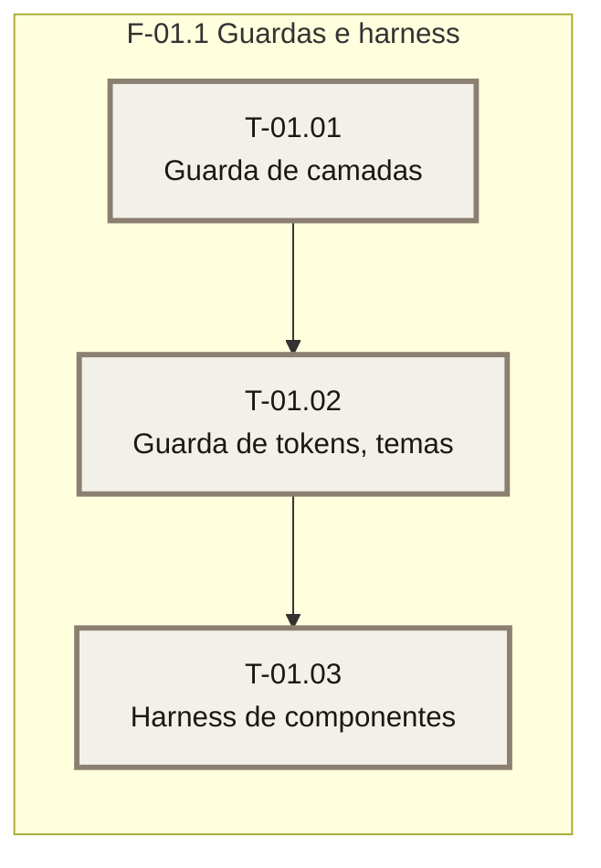

# Plano — Sprint 01 — Guardas e harness de teste

## Objetivo da sprint

Entregar a capacidade de testar o que a FT-01 vai tocar: guardas executáveis de camadas (PR-17) e de tokens e temas (PR-07), e um harness que renderiza componentes `.tsx`. Nenhuma funcionalidade de negócio.

## Critério de saída da sprint

`export DATABASE_URL="file:./dev.db" JWT_SECRET="<gerado>" && npm test` termina com 0 failed (suíte inteira).

## Riscos conhecidos

- O esbuild do vitest não transforma JSX sem `esbuild.jsx: 'automatic'` — `base/03-testes-seed-e-qualidade.md`.
- O teste de rotas exige build prévio — `base/03-testes-seed-e-qualidade.md`.

## Fora de escopo

- Mudança de texto ou de comportamento da interface — pertence à sprint 02 em diante.

## Fase F-01.1 — Guardas e harness

**Objetivo:** guardas de camadas e de tema, e o harness de componentes.

**Tasks:** T-01.01, T-01.02, T-01.03

**Critério de saída:** os três testes novos passam e a suíte inteira está verde.

**Roda em paralelo com:** nenhuma.

### Grafo de tasks

## Tasks

Os campos de cada task estão no frontmatter acima (fonte única; YAML e prosa dizem a mesma coisa).

- **T-01.01** — Guarda de camadas: a PR-17 deixa de ser prescrição e vira teste.
- **T-01.02** — Guarda de tokens, temas e celular: corrige o único literal de cor (`rgb(255 255 255 / 0.12)` em `src/estilos/global.css:92`) criando o token `--statusbar-hover`.
- **T-01.03** — Harness de componentes `.tsx`: habilita as sprints 02 e 03.
- **T-01.01** concluída em 2026-10-28 · suíte: 65 passed, 0 failed · real: 0,4 h (aprox.)
- **T-01.02** concluída em 2026-10-28 · suíte: 75 passed, 0 failed · real: 0,5 h (aprox.)
