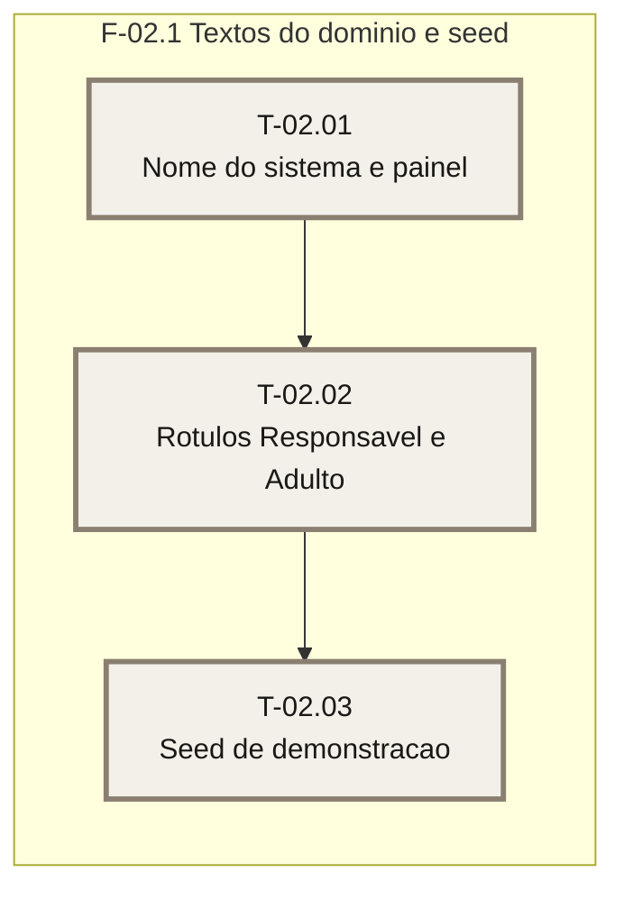

# Plano — Sprint 02 — Domínio Finanças da Família e demonstração

## Objetivo da sprint

Adaptar os textos do template ao domínio (PR-03), usar os rótulos Responsável e Adulto (PR-06 parcial, sem o papel `filho`) e entregar a seed de demonstração testável (PR-04).

## Critério de saída da sprint

`npm run build` seguido de `npm test` termina com 0 failed (suíte inteira).

## Riscos conhecidos

- `tests/rotas.test.ts:98` afirma o texto antigo do painel: o teste muda antes do código (`base/01-casca-e-navegacao.md`).
- O teste de rotas serve o build; cada task que muda HTML exige `npm run build` antes da suíte.

## Fora de escopo

- Filhos, lançamentos e mesada na seed — nascem nas FT-05, FT-03 e FT-06.
- Papel `filho` — FT-05.

## Fase F-02.1 — Textos do domínio e seed

**Objetivo:** textos do domínio, rótulos de papel e seed testável.

**Tasks:** T-02.01, T-02.02, T-02.03

**Critério de saída:** os testes da sprint passam e a suíte inteira está verde.

**Roda em paralelo com:** nenhuma.

### Grafo de tasks

## Tasks

Os campos de cada task estão no frontmatter acima (fonte única).

- **T-02.01** — D-03 e D-04. **T-02.02** — D-02. **T-02.03** — D-05 e D-13.
- **T-02.01** concluída em 2026-10-28 · suíte: 84 passed, 0 failed · real: 0,6 h (aprox.)
- **T-02.02** concluída em 2026-10-28 · suíte: 90 passed, 0 failed · real: 0,4 h (aprox.)
