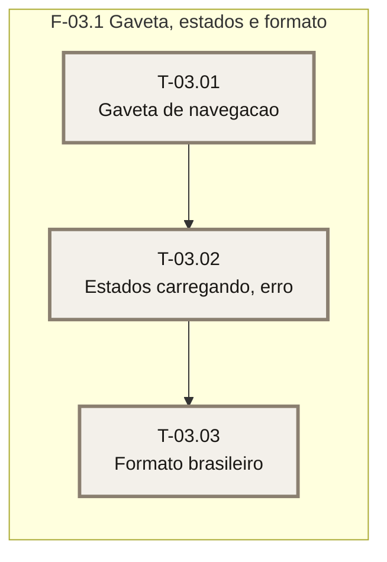

# Plano — Sprint 03 — Celular, estados e formato brasileiro

## Objetivo da sprint

Fechar a PR-16: celular com gaveta (abaixo de 768px), estados vazio, carregando e erro em português, e formato brasileiro de valor e data no fuso `America/Sao_Paulo`. O estado vazio já existe no painel (T-02.01).

## Critério de saída da sprint

`npm run build` seguido de `npm test` termina com 0 failed (suíte inteira).

## Riscos conhecidos

- Componente cliente com estado precisa renderizar no servidor e no vitest sem navegador — `base/01-casca-e-navegacao.md`.
- A gaveta hoje não tem acionador (`src/estilos/global.css:176-190`) — `base/00-LACUNAS.md`.

## Fora de escopo

- Telas de domínio e qualquer data ou valor exibido — FT-03 em diante.

## Fase F-03.1 — Gaveta, estados e formato

**Objetivo:** gaveta, estados e formato.

**Tasks:** T-03.01, T-03.02, T-03.03

**Critério de saída:** os testes da sprint passam e a suíte inteira está verde.

**Roda em paralelo com:** nenhuma.

### Grafo de tasks

## Tasks

Os campos de cada task estão no frontmatter acima (fonte única).

- **T-03.01** — D-06. **T-03.02** — D-07. **T-03.03** — D-08.
- **T-03.01** concluída em 2026-10-28 · suíte: 104 passed, 0 failed · real: 0,8 h (aprox.)
- **T-03.02** concluída em 2026-10-28 · suíte: 113 passed, 0 failed · real: 0,8 h (aprox.)
- Divergência da T-03.02: o `loading.tsx` do sistema coloca as páginas dentro de um limite de streaming; a negação de `/configuracoes/usuarios` para o adulto deixou de ser um 307 e passou a ser um `meta refresh` para `/` no corpo (status 200), sem nenhum dado de administração. O teste de rotas foi reescrito para afirmar o que importa (redirecionamento sem vazamento). Registrado como D-17 e como risco residual no FECHAMENTO.
- **T-03.03** concluída em 2026-10-28 · suíte: 121 passed, 0 failed · real: 0,4 h (aprox.)
- Fechamento da sprint 03 em 2026-10-28: `npm run build` + `npm test` → 13 arquivos, 121 passed, 0 failed.
