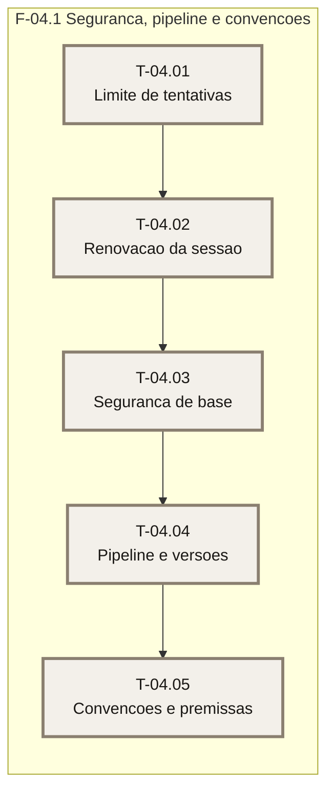

# Plano — Sprint 04 — Segurança, qualidade e convenções

## Objetivo da sprint

Fechar o que as premissas prometem e o código não cumpre: limite de tentativas (PR-12/PR-22), renovação de sessão (PR-05/PR-21), pipeline e versões fixadas (PR-15/PR-12/PR-23), e a revisão de convenções do B2 (stackx-detectar) com a rastreabilidade das premissas.

## Critério de saída da sprint

`npm run build`, `npm test`, `npm run lint` e `npm audit --audit-level=high` terminam com código 0.

## Riscos conhecidos

- Renovar sem revalidar ressuscitaria sessão derrubada por troca de senha — `base/02-autenticacao-e-sessao.md`.
- Atualizar o `package-lock.json` pode exigir rede — sem rede, edita-se a raiz do lock à mão e valida-se com `npm ls`.

## Fora de escopo

- Log estruturado, `/api/saude`, backup — FT-08. Trilha de atividade — FT-02.

## Fase F-04.1 — Segurança, pipeline e convenções

**Objetivo:** fechar segurança, pipeline e convenções.

**Tasks:** T-04.01, T-04.02, T-04.03, T-04.04, T-04.05

**Critério de saída:** os testes da sprint passam e a suíte inteira, lint, build e audit estão verdes.

**Roda em paralelo com:** nenhuma.

### Grafo de tasks

## Tasks

Os campos de cada task estão no frontmatter acima (fonte única).

- **T-04.01** — D-10. **T-04.02** — D-09. **T-04.03** — D-12 (confirma a PR-12 por teste). **T-04.04** — D-11. **T-04.05** — D-12, D-14; declara também os artefatos do planejamento (`docs/fundacao/`) e o `.gitignore`.
- **T-04.01** concluída em 2026-10-28 · suíte: 131 passed, 0 failed · real: 0,6 h (aprox.)
- **T-04.02** concluída em 2026-10-28 · suíte: 141 passed, 0 failed · real: 0,9 h (aprox.)
- Divergência da T-04.02: `src/lib/renovacao.ts` foi acrescentado (a conta do intervalo precisa existir fora do componente cliente, porque o layout, do servidor, a chama); o teste passou a vermelho de verdade quando a função estava dentro do arquivo cliente (500 em todas as páginas).
- **T-04.03** concluída em 2026-10-28 · suíte: 150 passed, 0 failed · real: 0,4 h (aprox.)
- **T-04.04** concluída em 2026-10-28 · suíte: 158 passed, 0 failed (via npm run verificar) · real: 0,6 h (aprox.)
- **T-04.05** concluída em 2026-10-28 · suíte: 173 passed, 0 failed · real: 1,0 h (aprox.)
- Fechamento da sprint 04 em 2026-10-28: `npm run lint`, `npx tsc --noEmit`, `npm run build` e `npm test` → 19 arquivos, 173 passed, 0 failed; `npm run verificar` já tinha passado na T-04.04. Divergência: `docs/stack/LACUNAS.md` foi criado pelo stackx-detectar (não estava na lista).
